# giro.shop

Mercatino dell'usato tra privati in Ticino, costruito attorno all'AI: l'annuncio nasce da una foto, la ricerca capisce
le frasi (e il significato delle parole) e un connettore MCP permette di cercare, salvare ricerche e pubblicare
parlando con il proprio assistente.

**Online:** https://giro.omarbeltraminelli.com, un prototipo con annunci di prova, che gira su un Mac mini con
Supabase in locale ([come](deploy/macmini/LEGGIMI.md)).

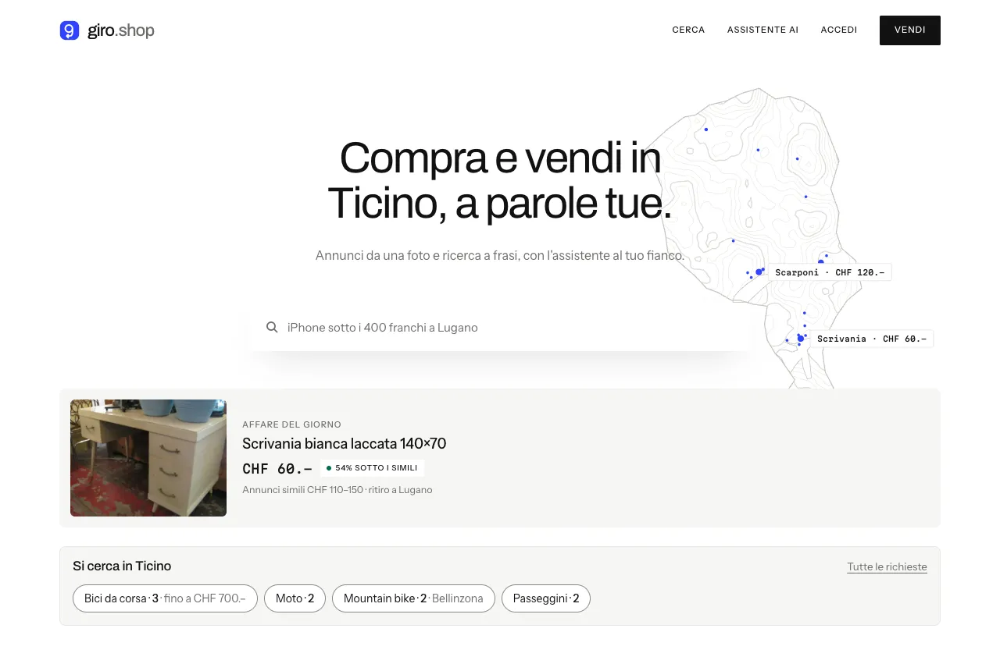

## Indice

- [Funzionalità](#funzionalità)
  - [Cercare](#cercare)
  - [La scheda annuncio](#la-scheda-annuncio)
  - [Vendere](#vendere)
  - [Trattare](#trattare)
  - [Avvisi ed email](#avvisi-ed-email)
  - [Fiducia e moderazione](#fiducia-e-moderazione)
  - [Assistente AI (MCP)](#assistente-ai-mcp)
  - [Ricavi](#ricavi)
  - [Privacy e dati](#privacy-e-dati)
  - [Sul telefono](#sul-telefono)
- [Come è fatto](#come-è-fatto)
- [Avvio in locale](#avvio-in-locale)
- [Test](#test)
- [Online sul Mac mini](#online-sul-mac-mini)
- [Struttura](#struttura)
- [Foto di esempio](#foto-di-esempio)
- [Cosa manca](#cosa-manca)

## Funzionalità

### Cercare

- **Frasi al posto dei filtri.** «scrivania in legno sotto i 150 franchi vicino a Lugano» diventa categoria, prezzo,
  zona con raggio e materiale. Ogni filtro capito è un chip che si toglie con un clic; i risultati si aggiornano mentre
  scrivi, senza ricaricare la pagina.
- **Si scorre e basta.** Gli annunci arrivano a pagine da 24 mentre scorri, anche nella home; l'indirizzo ricorda fin
  dove sei arrivato. Senza JavaScript resta il bottone «Mostra altri».
- **Ricerca per significato.** «sofà» trova il divano, «Fahrrad» le bici, «per fare il caffè» la macchina del caffè,
  anche se l'annuncio non contiene quelle parole. Usa un modello che gira sul server (EmbeddingGemma), non un servizio
  esterno. Gli annunci trovati così sono segnati «stesso significato» e vengono dopo quelli con le parole esatte;
  prezzo, zona e gli altri filtri valgono comunque.
- **Motivi di pertinenza** su ogni scheda («noce massello · sotto budget»), **giudizio sul prezzo** (sotto mercato,
  prezzo giusto, sopra mercato) e **stato** (nuovo oggi, trattabile, in trattativa, regalo).
- **Ordine:** pertinenza, più recenti, prezzo, più vicini. Gli annunci si caricano a pagine con «Mostra altri».
- **Distanze da te:** scrivi il tuo comune (con ricerca, anche per CAP) o usa la posizione una volta sola; il comune
  resta solo nel browser.
- **Suggerimenti** mentre scrivi e **ricerche recenti** (salvate solo nel browser).
- **Cerca con una foto:** fotografi un oggetto e Claude scrive la ricerca (serve la chiave di Claude).
- **Affare del giorno** in home e pagina **Confronta** per mettere annunci uno accanto all'altro.
- **Cercasi:** cosa cercano le persone in Ticino, dalle ricerche salvate, per oggetto e zona, con il budget tipico. Solo
  numeri aggregati e solo dove le persone sono almeno due; «Ce l'ho, lo vendo» apre Vendi con l'oggetto già scritto.
- **«Si cerca in Ticino»** in home: le stesse richieste come striscia di etichette (si scorre col dito), prima quelle
  della propria zona. Un tocco apre «Ce l'ho, lo vendo», «Lo cerco anch'io» (salva la stessa ricerca e fa crescere il
  conto) e «Vedi gli annunci»; chi vende vede in testa il proprio annuncio più cercato. Si carica a parte (isola del
  server), così la home resta in cache uguale per tutti; con meno di due richieste resta il riquadro semplice.

<p>
  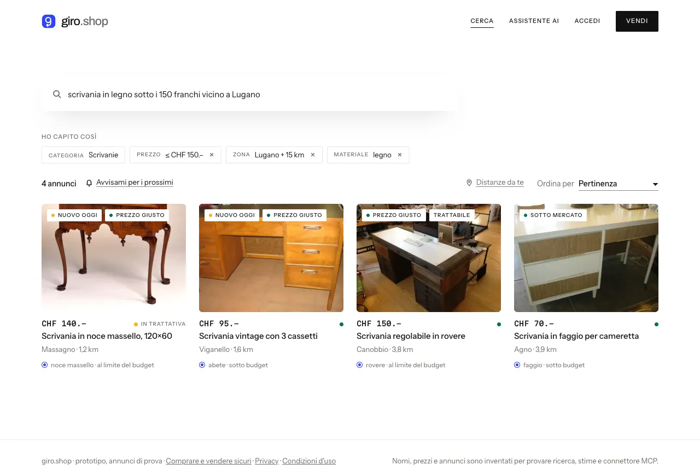
  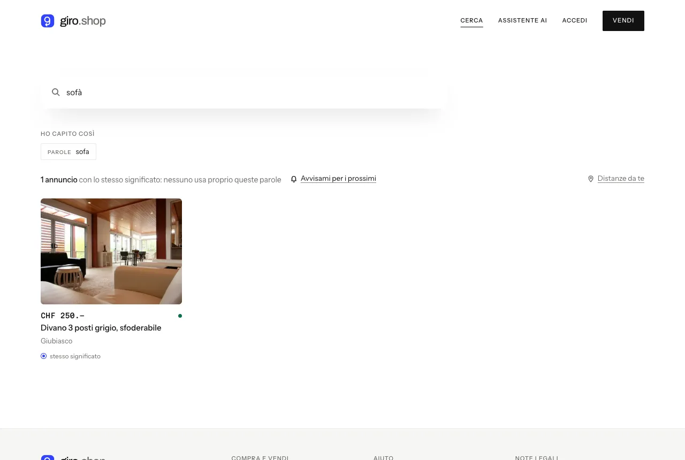
</p>
<p>
  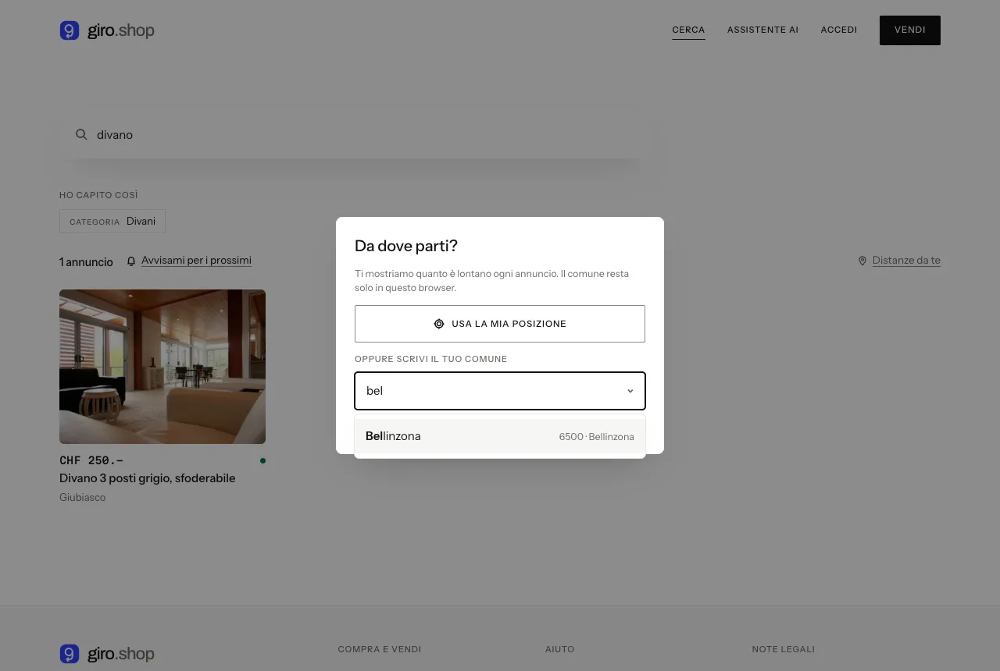
  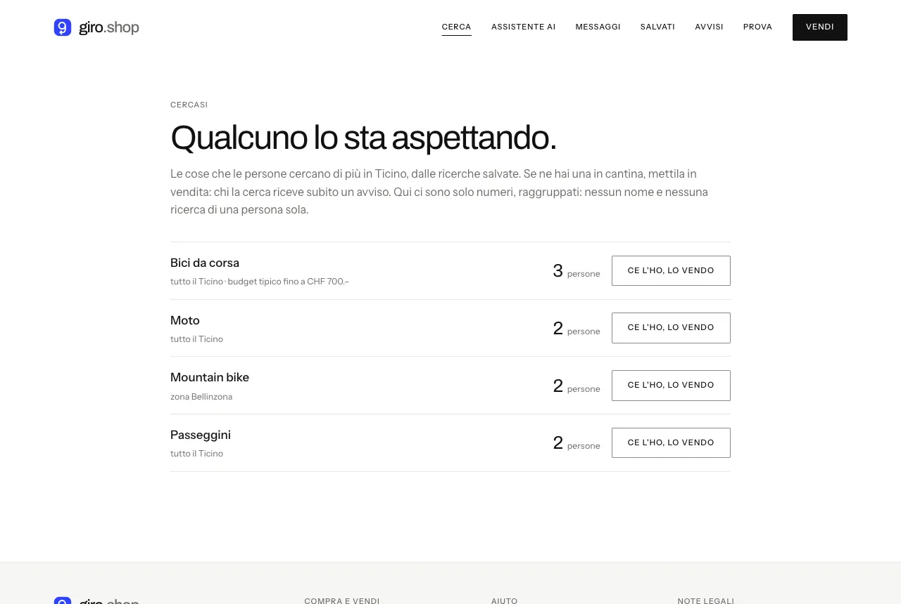
</p>

### La scheda annuncio

- Foto, prezzo, **stima dagli annunci simili** (pubblicati e venduti) e giudizio sul prezzo.
- **In sintesi:** i punti chiave, scritti da Claude o, senza chiave, da regole semplici.
- **Domande pubbliche** con risposta di chi vende e voto «utile», così le stesse domande non arrivano dieci volte.
- **Storico del prezzo** con grafico; chi ha salvato l'annuncio viene avvisato quando il prezzo cala.
- **Traduzione** in tedesco, francese e inglese (con Claude).
- Salva (cuore), confronta, scrivi a chi vende, segnala. Profilo di chi vende con valutazioni e tempi di risposta.
- Etichette **«In vetrina»** (vetrina mirata pagata) e **«Negozio»** (account Pro); sui mobili grandi senza spedizione,
  le ditte di trasporto della zona.
- Per Google: dati strutturati (Product/Offer), link canonici, sitemap e robots.txt.

<p>
  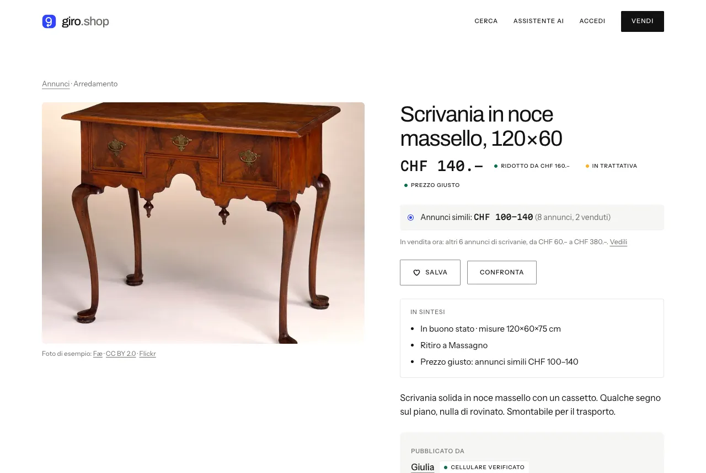
  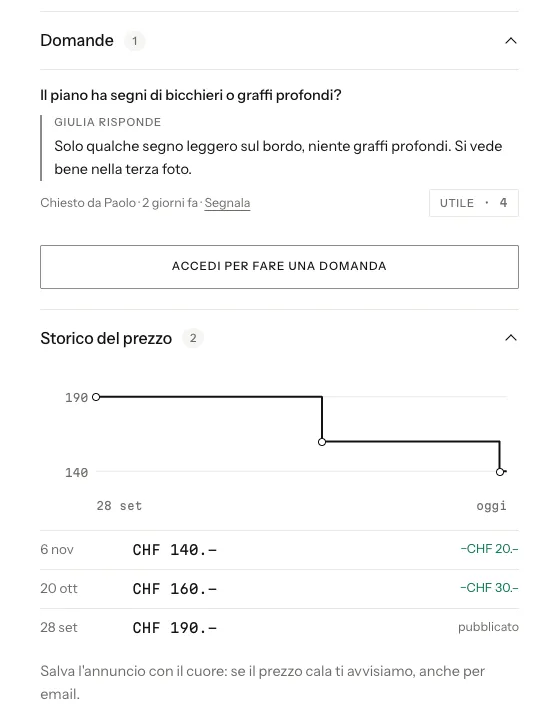
</p>

### Vendere

- **Scatta e vendi:** da 1 a 5 foto e due righe. Claude riconosce l'oggetto, scrive titolo, descrizione, condizione,
  dettagli e parole chiave e propone una fascia di prezzo dagli annunci simili. I campi scritti dall'assistente hanno
  l'anello blu: si controllano prima di pubblicare. Senza chiave di Claude la bozza nasce dal testo con regole
  semplici, e la pagina lo dice.
- Comune di ritiro con ricerca, spedizione con costo facoltativo, prezzo trattabile.
- **I miei annunci:** modifica con salvataggio automatico (niente bottoni «Salva», una notifica conferma), foto da
  aggiungere e riordinare, venduto (con prezzo e a chi), archivia, rimetti in vendita, elimina, link al proprio
  profilo pubblico.
- **Scadenza:** gli annunci restano online 90 giorni, con promemoria 3 giorni prima e rinnovo con un tocco.
- **Valutazioni** reciproche dopo una vendita, solo tra chi ha davvero trattato.
- **Lo cercano in 4:** nella bozza, quante persone hanno una ricerca salvata per un oggetto così e con che budget
  (anche chi cerca a un prezzo più basso), e se il prezzo scelto è sopra il budget di tutti.
- **Svuota casa:** fino a 10 foto di stanze, cantina o trasloco. Con Claude ogni oggetto vendibile diventa una bozza,
  ritagliata dalla foto nel browser; senza chiave, una bozza per foto dal testo scritto sotto. Si controllano titoli e
  prezzi e si pubblica tutto in un colpo. In cima a Vendi e a Svuota casa si sceglie: «Un oggetto» o «Tante cose».
- **Statistiche** per annuncio: visite (anonime, una per sessione, quelle di chi vende non contano), salvati, contatti,
  domande, quante persone lo cercano, prezzo rispetto al mercato, giorni per vendere.
- **Ribasso automatico:** −5/10/15/20% ogni 7–30 giorni, mai sotto il minimo scelto; chi ha salvato l'annuncio riceve
  l'avviso a ogni ribasso. Se l'annuncio è sopra il mercato e nessuno scrive da 10 giorni, un consiglio con il prezzo
  suggerito e «Abbassa» con un tocco.
- **Offerta minima** per annuncio, privata come il minimo del ribasso (stanno in una tabella che legge solo chi vende).

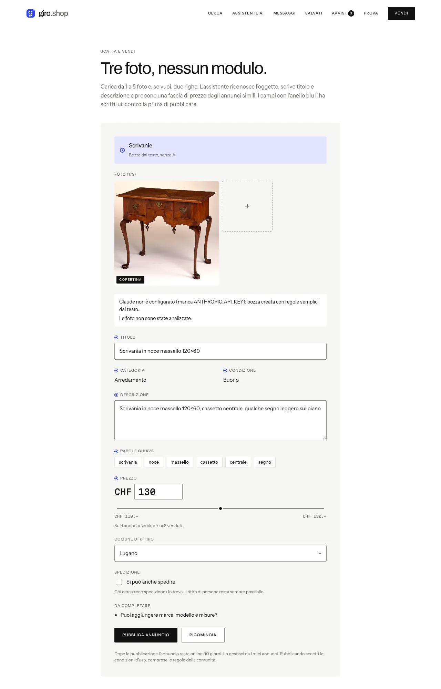

<p>
  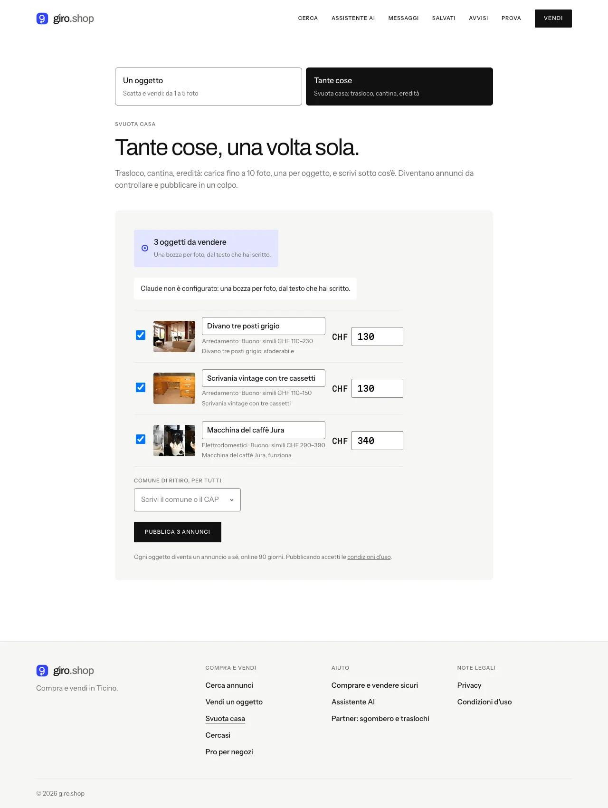
  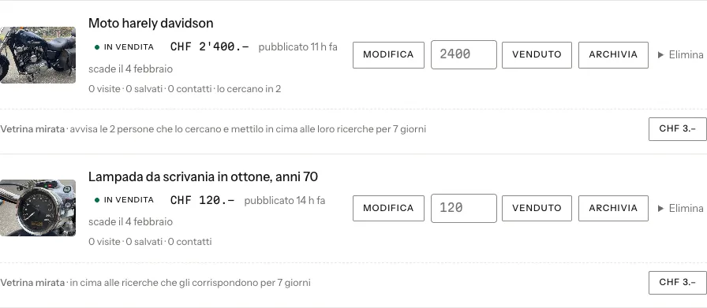
</p>

### Trattare

- Messaggi tra chi compra e chi vende, con **offerte**: accetta, rifiuta, ritira, controfferta. Un'offerta accettata
  mette l'annuncio «in trattativa». La conversazione si aggiorna da sola.
- **Ritiro concordato:** giorno, ora e luogo dentro l'offerta o in una proposta a parte, accettata con un tocco.
  Promemoria a tutti e due nelle 24 ore prima; dopo il ritiro chi vende risponde a «com'è andato?» con «Sì, venduto»
  (prezzo e chi ha comprato già scelti, poi le valutazioni) o «No, è ancora in vendita».
- **Assistente venditore**, da accendere in «I miei annunci»: risponde a nome di chi vende alle domande ripetitive
  (disponibile, dove, spedizione, trattabile) con i dati dell'annuncio e le risposte pubbliche già date (con Claude se
  c'è la chiave, altrimenti con regole), rifiuta le offerte sotto il minimo senza dirlo e propone il primo orario libero
  per il ritiro. Le risposte sono segnate come automatiche, tace per 15 minuti quando scrive chi vende e accettare resta
  una decisione della persona.
- **Avvisi anti-truffa** sotto i messaggi ricevuti: pagamento in anticipo, codici SMS, dati della carta, corrieri
  «suoi», link esterni, inviti a uscire dal sito. Li vede solo chi riceve, con il link per segnalare.
- Consigli di sicurezza nella conversazione e la guida «Comprare e vendere sicuri».

<p>
  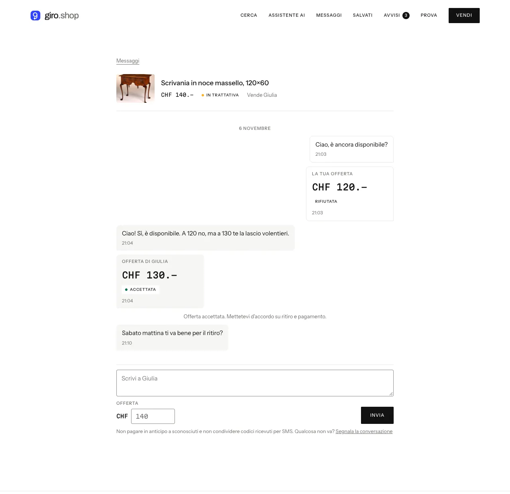
  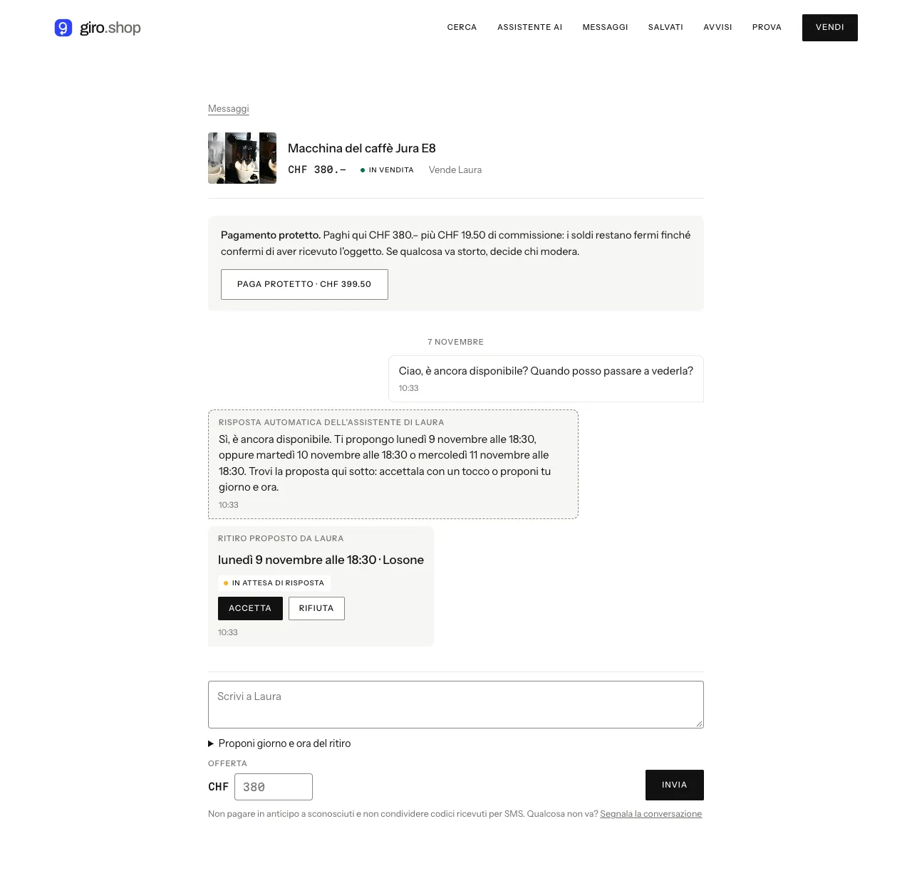
</p>

### Avvisi ed email

- **Ricerche salvate:** un avviso quando arriva un annuncio che corrisponde, anche detto con altre parole
  («sofà» avvisa per un divano, con una soglia di somiglianza più alta di quella della ricerca).
- Avvisi per prezzi ridotti e vendite degli annunci salvati, domande e risposte, valutazioni, scadenze, consigli per chi
  vende (ribassi fatti, prezzo da rivedere, «com'è andato il ritiro?») e promemoria dei ritiri.
- Tutto resta nel sito, sotto la campanella. Per email si sceglie **quando** (subito, un riassunto al giorno alle 18,
  mai) e **per cosa** (sette tipi). Ogni email ha il link per spegnere solo quel tipo, anche con un clic dal programma
  di posta.
- Email con il disegno del sito (logo, caratteri, etichette, schede con foto e prezzo), anche quelle di accesso di
  Supabase, generate dallo stesso modello. Partono con Resend dal dominio `giro.omarbeltraminelli.com`.

<p>
  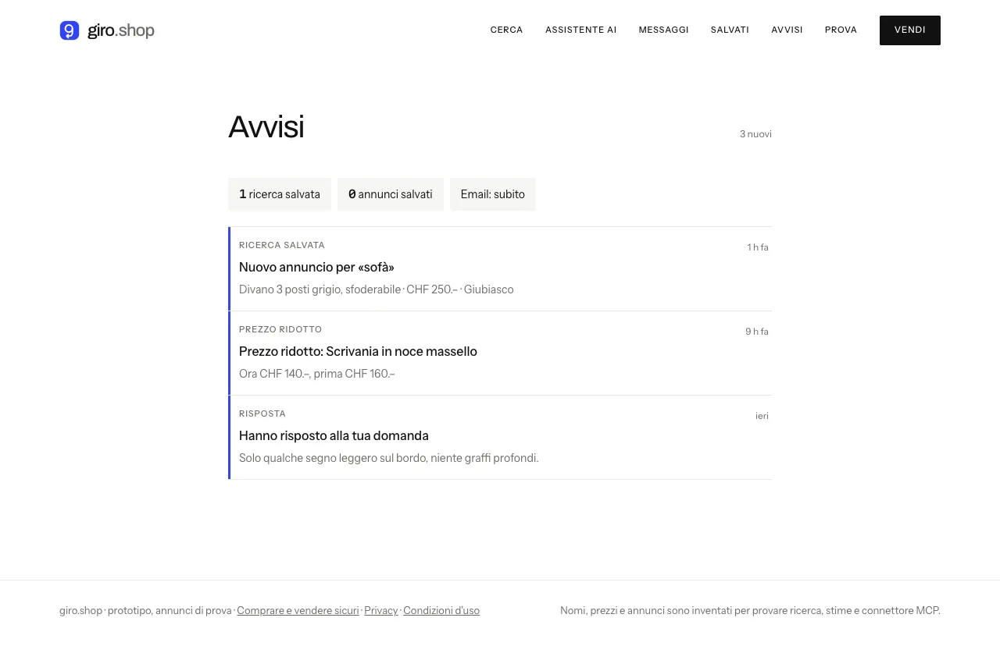
  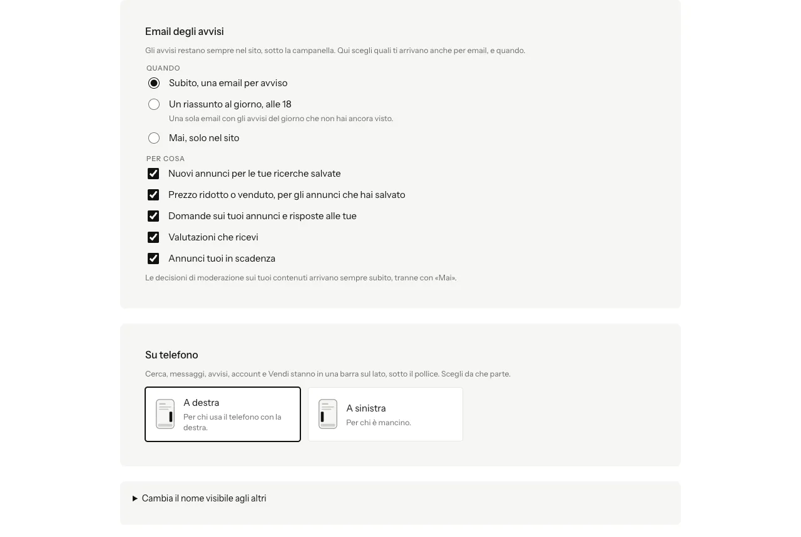
</p>

### Fiducia e moderazione

- **Cellulare verificato** con un codice via SMS (il numero non è mai mostrato).
- **Segnalazioni** di annunci, domande, valutazioni, utenti e conversazioni (solo da chi ne fa parte). Dopo alcune
  segnalazioni di persone diverse il contenuto si nasconde finché qualcuno non lo controlla.
- **Agente di moderazione** (Claude): legge la segnalazione, il contenuto, le foto dell'annuncio, chi ha pubblicato e
  quanto è affidabile chi segnala, poi prende una sola decisione. Nasconde o respinge da solo solo con sicurezza almeno
  0.85; su utenti e conversazioni decide sempre una persona. I limiti sono nel codice, non solo nel prompt.
- **Rischio truffa degli annunci:** a ogni pubblicazione o modifica un punteggio con i motivi (pagamento anticipato,
  contatti per uscire dal sito, link, prezzo molto sotto gli annunci simili, testo copiato da un'altra persona, cellulare
  non verificato). Sopra 0.5 l'annuncio va in cima alla moderazione: «Nascondi» passa dagli stessi passi delle
  segnalazioni (registro, avviso, contestazione, annullamento), «Va bene» lo toglie finché il rischio non sale.
- **Pagina di moderazione** per le persone: decisioni, proposte dell'agente, registro, annullamento.
- **Contestazioni:** chi riceve una decisione la può contestare; la rivede sempre una persona.
- Sospensione degli account per violazioni gravi o ripetute.


### Assistente AI (MCP)

Due indirizzi per Claude o un altro client MCP:

| Indirizzo | Accesso | Strumenti |
| --- | --- | --- |
| `/mcp` | nessuno | `search_listings`, `get_listing`, `estimate_price`, `create_draft`, `save_search` (con link di conferma) |
| `/mcp/account` | OAuth 2.1 | gli stessi, più `save_search`, `my_saved_searches`, `delete_saved_search`, `publish_listing`, `my_listings`, `update_listing` a nome della persona |

- **OAuth 2.1 completo:** metadati (RFC 8414 e 9728), registrazione dinamica dei client, PKCE obbligatorio, token di
  un'ora con rinnovo a rotazione, revoca, `iss` nella risposta (RFC 9207). Funziona con claude.ai, Claude Code e MCP
  Inspector.
- **Pagina di consenso** che dice cosa l'assistente potrà e non potrà fare; permessi separati per ricerche e annunci.
- **Assistenti collegati** in «I miei annunci», da scollegare con un clic (smettono subito di funzionare).
- `publish_listing` accetta foto come indirizzi https, scaricate in modo sicuro (niente reti interne, solo immagini
  vere fino a 5 MB); senza foto l'annuncio resta in bozza. In auto, moto e affitti, senza negozio Pro, resta in bozza
  anche con le foto: la pubblicazione si paga dal sito («Paga e pubblica» in I miei annunci).
- Le risposte segnalano che titoli e descrizioni sono testo degli utenti, da trattare come dati.

<p>
  
  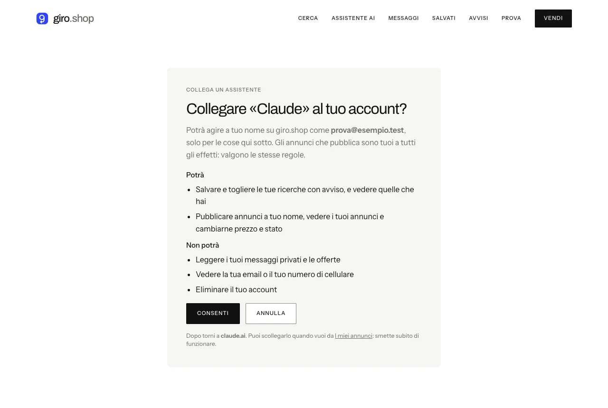
</p>

### Ricavi

Pubblicare resta gratis per i privati. Per ora ogni pagamento è **di prova**: la pagina `/pagamento/<id>` mostra il
riepilogo e un bottone che fa come se si fosse pagato, senza addebiti (`src/lib/payments.ts` dice dove agganciare un
fornitore vero). Gli importi li decide sempre il server, da `src/core/pricing.ts`.

- **Pro per negozi** (`/pro`, CHF 12.90 al mese o 119.88 all'anno): la pagina venditore diventa la pagina del negozio
  (nome, indirizzo, orari, sito, telefono) e ogni annuncio porta «Negozio»; **import del catalogo** da CSV (colonne
  riconosciute in italiano, tedesco e inglese, separatore indovinato, anteprima con gli errori riga per riga);
  **prezzi in blocco a parole** («tutti gli sci −20% fino a domenica»: anteprima, conferma, ritorno ai prezzi di prima
  alla scadenza o con un tocco); i **numeri del negozio**; auto, moto e affitti senza costi.
- **Vetrina mirata** (CHF 3 per 7 giorni): dal «I miei annunci», l'annuncio va in cima alle ricerche che gli
  corrispondono, con l'etichetta «In vetrina», e chi ha una ricerca salvata che lo riguarda riceve subito un avviso.
- **Annunci a pagamento** per auto (CHF 9.90), moto e scooter (4.90) e **affitti** (19.90, categoria nuova con il prezzo
  al mese): senza Pro l'annuncio nasce in bozza e si pubblica dopo il pagamento. Lo controlla un trigger nel database,
  quindi vale anche per il connettore MCP e per chi scrive direttamente nel database.
- **Partner locali** (`/partner`): sgombero, traslochi, trasporto, riparazioni, pulizie, filtrati per zona. Le ditte si
  candidano dalla pagina, chi modera le accende; compaiono dopo Svuota casa e sui mobili grandi senza spedizione. Ogni
  richiesta di preventivo arriva al partner per email e resta registrata con la tariffa (CHF 5), da fatturare a fine mese
  dalla pagina di moderazione.
- **Pagamento protetto** (commissione a chi compra: 5% + 50 centesimi, al massimo CHF 30): chi compra paga dalla
  conversazione, i soldi restano fermi; «Ho ricevuto l'oggetto» li manda a chi vende e segna l'annuncio venduto, «C'è un
  problema» li blocca finché decide chi modera, chi vende può rimborsare. Senza problemi vanno a chi vende 2 giorni dopo
  il ritiro. **Spento online** finché non c'è il parere di un giurista: si accende con `PIAZZA_PAGAMENTO_PROTETTO=on`
  (in sviluppo è sempre acceso).

<p>
  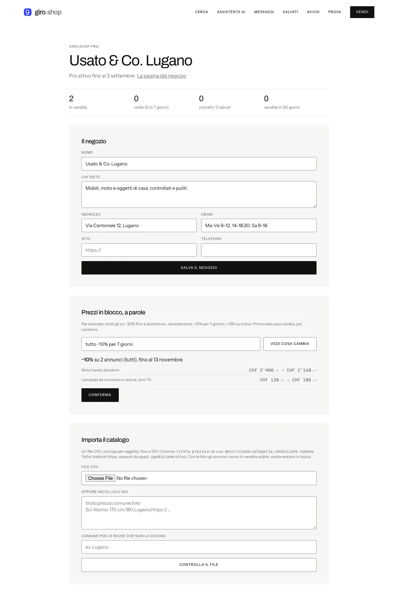
  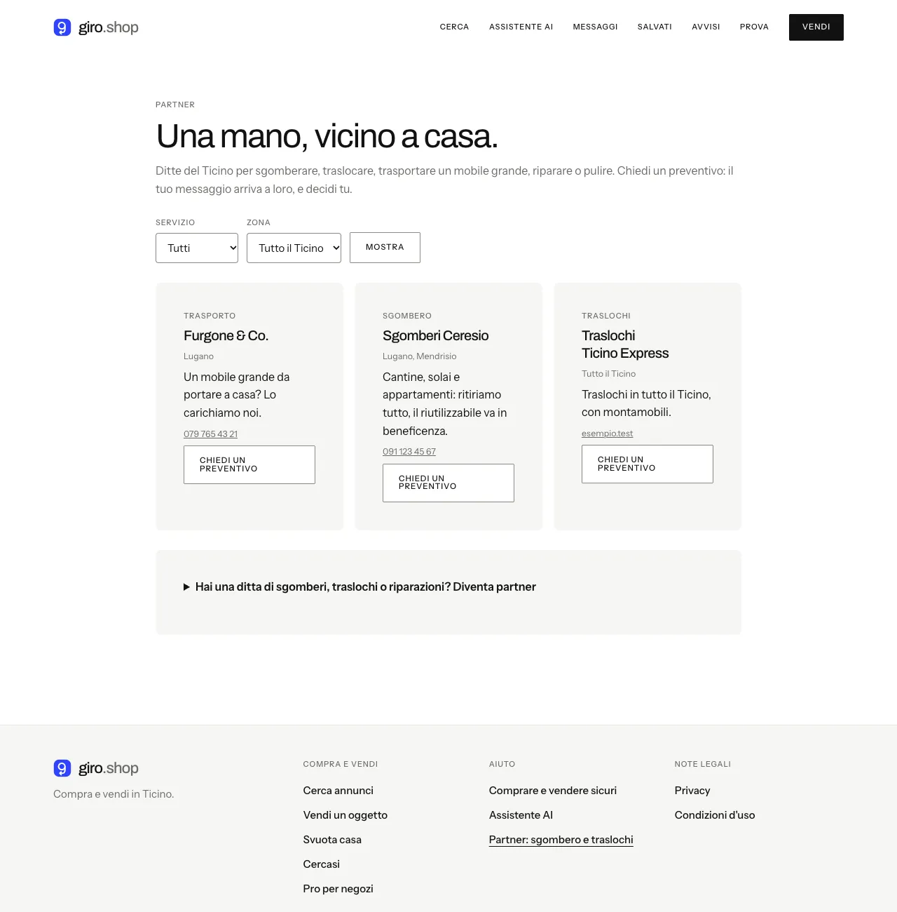
</p>

### Privacy e dati

- Informativa sulla privacy (nLPD) e condizioni d'uso, con le regole della comunità prese dalla stessa fonte usata
  dall'agente di moderazione.
- **Scarica i tuoi dati** (un file JSON con tutto) ed **elimina l'account** dalla pagina dell'account.
- Solo cookie tecnici, niente tracciamento. Accesso con link via email, senza password.

### Sul telefono

- La ricerca sta in basso, sotto il pollice, e sale sopra la tastiera.
- Cerca, messaggi, avvisi, salvati, account e **Vendi** stanno in una barra sul lato, sopra la ricerca o la barra
  della scheda. Esce di lato scorrendo verso il basso e torna scorrendo verso l'alto.
- Per chi è mancino la barra va a sinistra: si sceglie nella pagina dell'account e vale su tutti i dispositivi.

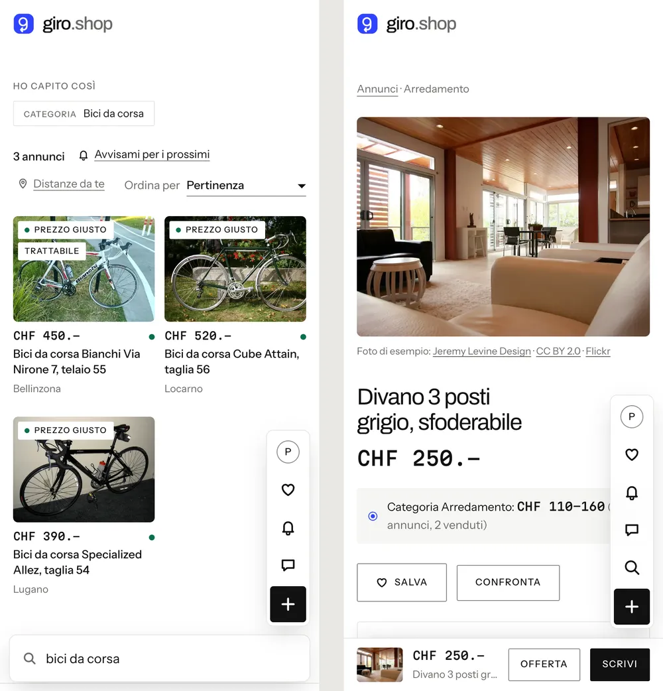

## Come è fatto

- **Astro 7** con rendering sul server (adapter Node), isole **Preact** per le parti interattive, Astro Actions per i
  moduli, server islands per le parti personali delle pagine in cache.
- **Supabase**: Postgres con regole RLS (ognuno vede e modifica solo ciò che può), accesso con link via email (PKCE),
  Storage per le foto. Funzioni e trigger nel database per offerte, ritiri, scadenze, segnalazioni, sospensioni e
  tariffe di pubblicazione.
- **Un solo nucleo** in `src/core` (frase → filtri, ricerca, stime, bozze, comuni) usato dal sito, dalle Actions e dal
  server MCP: le stesse regole per persone e agenti. Il server tiene in memoria una copia degli annunci pubblicati,
  aggiornata dopo ogni modifica.
- **Claude** (`claude-opus-5-5`, facoltativo): bozze da foto, Svuota casa, sintesi, traduzioni, ricerca con foto,
  moderazione, risposte dell'assistente venditore.
  Senza chiave tutto il resto funziona.
- **EmbeddingGemma** (via transformers.js, sul server, circa 200 MB scaricati una volta) per la ricerca per significato;
  i vettori stanno in una tabella che solo il server legge e scrive.
- Lavori periodici (promemoria di scadenza, annunci scaduti, ribassi automatici, consigli sul prezzo, promemoria dei
  ritiri, prezzi di prima alla fine delle modifiche in blocco, pagamenti protetti rilasciati dopo il ritiro, riassunto
  delle email, vettori nuovi) agganciati alle richieste, al massimo ogni 15 minuti.

## Avvio in locale

Serve Docker acceso.

```bash
pnpm install
cp .env.example .env              # poi compila le chiavi (vedi sotto)
pnpm exec supabase start          # Supabase in locale: database, migrazioni e dati di prova
pnpm dev                          # http://localhost:4321
```

Da `pnpm exec supabase status` copia in `.env`:
- `API_URL` in `PUBLIC_SUPABASE_URL`;
- `PUBLISHABLE_KEY` in `PUBLIC_SUPABASE_PUBLISHABLE_KEY`;
- `SECRET_KEY` in `SUPABASE_SECRET_KEY`.

La CLI di Supabase e pnpm hanno versioni fisse nel progetto.

| Variabile | A cosa serve |
| --- | --- |
| `PUBLIC_SUPABASE_URL`, `PUBLIC_SUPABASE_PUBLISHABLE_KEY` | Supabase, come lo vedono i browser |
| `SUPABASE_SECRET_KEY` | Solo server: avvisi, email, moderazione, OAuth, ricerca per significato |
| `SUPABASE_INTERNAL_URL` | Facoltativa: indirizzo interno di Supabase per il server (dietro un tunnel) |
| `PIAZZA_BASE_URL` | Indirizzo pubblico del sito (link nelle email, OAuth, sitemap) |
| `SMTP_HOST`, `SMTP_PORT`, `SMTP_USER`, `SMTP_PASS`, `MAIL_FROM` | Email degli avvisi; in locale Mailpit |
| `ANTHROPIC_API_KEY` | Facoltativa: Claude |

- Studio: http://127.0.0.1:54323 · Mailpit (email di accesso in sviluppo): http://127.0.0.1:54324
- L'accesso è con link via email: va aperto nello stesso browser da cui è stato chiesto.
- In locale il cellulare si verifica con numeri di prova a codice fisso (es. 079 123 45 67 → 123456).
- Utente di prova: `prova@esempio.test` (moderatore).

## Test

| Comando | Cosa verifica |
| --- | --- |
| `pnpm test` | 129 test unitari: ricerca, significato, stime, bozze, avvisi, email, OAuth, SEO, MCP, ribassi, ritiri, assistente venditore, rischio truffa, domanda, Svuota casa, prezzi in blocco, import del catalogo, commissioni |
| `pnpm test:e2e` | 29 test nel browser (Playwright con il Chrome installato), con accessi veri via email: ricerca, significato, distanze, Scatta e vendi, avviso per significato, offerta accettata, ritiro e vendita confermata, assistente venditore, avvisi anti-truffa e moderazione, Cercasi, la striscia in home e «lo cercano in», Svuota casa, vetrina mirata, auto a pagamento, negozio Pro, partner, pagamento protetto, ricerca salvata, email, collegare un assistente |
| `pnpm test:db` | 117 controlli di sicurezza sul database con utenti temporanei (RLS, permessi, trigger, pagamenti, tariffe) |
| `pnpm test:moderazione` | 37 controlli sull'agente di moderazione con un modello finto che segue un copione |
| `pnpm test:oauth` | 25 controlli sul login OAuth del connettore con il client MCP ufficiale |
| `pnpm mcp:smoke` | Prova il server MCP via HTTP |
| `pnpm screenshots` | Rifà le immagini di questo README |
| `pnpm email:anteprima <cartella>` | Anteprima delle email (accesso, avviso, riassunto) per computer e telefono |
| `pnpm email:modelli` | Rigenera i modelli delle email di Supabase dal disegno comune (`src/lib/email-design.ts`) |

I test nel browser e i controlli servono `pnpm exec supabase start` e `pnpm dev` accesi; puliscono quello che creano.

## Online sul Mac mini

Il sito gira sul Mac mini di casa con Supabase in locale ed è pubblico attraverso un tunnel Cloudflare: passano solo il
sito e l'API di Supabase che serve ai browser. Per aggiornarlo, dal MacBook:

```bash
git push macmini main && ssh macmini 'piazza/deploy/macmini/aggiorna.sh'
```

Tutto il resto (porte, avvio automatico, email vere, riavvii) è in [deploy/macmini/LEGGIMI.md](deploy/macmini/LEGGIMI.md).

## Struttura

```text
src/
  core/        logica di dominio senza Astro: frasi → filtri, ricerca, stime, bozze, comuni, email, OAuth
  lib/         lato server: Supabase, email, avvisi, moderazione, ricerca per significato, OAuth, manutenzione
  actions/     Astro Actions (moduli del sito)
  mcp/         server MCP (HTTP e stdio) e strumenti dell'account
  pages/       pagine ed endpoint (anche /pro, /partner, /pagamento, /oauth e /.well-known)
  components/  schede, ricerca, isole Preact (Scatta e vendi, Svuota casa, comune ricercabile, foto)
supabase/      configurazione, migrazioni e dati di prova
tests/         test unitari (vitest)
e2e/           test nel browser (Playwright)
scripts/       controlli su database, moderazione e OAuth, screenshot, foto di esempio
deploy/macmini/  avvio sul Mac mini: launchd, tunnel, aggiornamento, guida
docs/          proposta di progetto e screenshot
```

## Foto di esempio

Le foto degli annunci di prova sono **foto di esempio** prese da [Openverse](https://openverse.org) (Flickr e
Wikimedia Commons), solo con licenze CC0, pubblico dominio o CC BY. Non ritraggono gli oggetti reali degli annunci.
Autore, licenza e fonte sono in `src/data/photos.ts` e compaiono sotto la foto nella scheda annuncio, come richiede
CC BY. Per cambiarne una: `node scripts/fetch-photos.ts sheet l-029`, poi si aggiorna `PICKS` nello script e si
rilancia `build`.

## Cosa manca

- Fornitore di pagamento vero (Stripe o Payrexx, con TWINT): ora tutti i pagamenti sono di prova
- Parere di un giurista sul pagamento protetto (legge sul riciclaggio) prima di accenderlo online
- Fornitore SMS per verificare il cellulare online
- Chiave di Claude online per bozze da foto, Svuota casa con il ritaglio degli oggetti, risposte dell'assistente
  venditore, traduzioni, ricerca con foto e agente di moderazione
- Elenco ufficiale dei comuni con coordinate swisstopo (ora 33 comuni con coordinate approssimative)
- Testi legali: dati tra parentesi quadre da completare e revisione di un giurista
